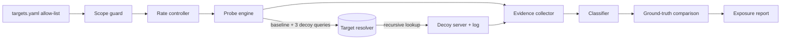

# RecurseCheck: Authorised DNS Resolver Exposure Assessment

RecurseCheck is a reproducible tool that tests whether designated DNS servers allow **recursive queries from an
external client**, and classifies each server's behaviour as **Recursive**, **Refused**, **Authoritative-only** or
**Inconclusive**. It is evaluated against a Docker lab of 20 servers whose correct labels are known in advance.

Instead of trusting the RA flag in a reply, RecurseCheck asks the server to look up a unique name that only a
**decoy server** we control can answer. If the decoy server's log shows that name, the target really performed the
lookup. That is evidence of what the server *did*, not only what it *claims*.

> Scope: one infrastructure class (DNS recursion), up to 20 authorised servers, a controlled test zone. No Internet
> scanning, no spoofed traffic, no amplification or stress testing.

## Features

- **Decoy-server evidence:** unique per-query names, matched against the decoy server's log.
- **Four-class classifier** with ordered rules, reason codes, an evidence-strength rating and a decision trace for every verdict.
- **Seeded ground truth:** `targets.yaml` holds the expected label of each of the 20 lab servers; results are scored with a confusion matrix, precision/recall and coverage.
- **Baseline comparison:** every run also scores a naive single-query RA-flag scanner on the same evidence.
- **Rate controls:** token buckets per server and overall, configurable timeout and retry limits. In the web UI you choose 1 to 10 queries to send within one second (hard cap 10); every query in a test uses a different unique name.
- **Live counters:** queries sent, replies received and names seen by the decoy server, per second and per query, so a resolver that limits its own query rate (t04: 5 per second, t05: 3 per second) can be seen dropping the excess.
- **Safety:** allow-list scope guard (lab network only, max 20, A/TXT only), dry-run mode, Ctrl+C kill switch, append-only audit log of every query, real source address only.
- **Reproducibility:** each run saves its seed and settings; `--replay` repeats it.
- **Web interface:** choose a lab resolver, choose the **vantage point** (external or internal client) with a toggle, click *Test resolver*, see YES / NO / UNKNOWN with the evidence.
- **Exposure report:** a self-contained HTML report (print to PDF) with results, accuracy, remediation advice and rate-control proof.

## Quick start (macOS, Docker Desktop or OrbStack)

```bash
python3 -m venv .venv && source .venv/bin/activate
pip install pyyaml
python generate_lab.py              # writes generated/ and docker-compose.yml from targets.yaml
docker compose up -d --build        # first build takes a few minutes
docker compose ps                   # about 25 containers, all running
sh verify.sh                        # six manual checks of the lab (expected results are printed)
```

macOS cannot reach the container addresses (10.10.x.x) directly, so the tool runs **inside** the lab.

### Web interface

Open **http://localhost:8080**. Pick a resolver, pick where the query comes from, and click *Test resolver* (or *Test all*).

| Toggle | Source address | What it answers |
|---|---|---|
| External client (default) | 10.10.2.20, outside 10.10.1.0/24 | Does the server recurse for an outsider? This is the exposure question. |
| Internal client | 10.10.1.20, inside 10.10.1.0/24 | Does the server work for its own users? Policy-refusing servers (t06-t09) answer Recursive here and Refused from outside. |

The rate slider under the toggle sets how many queries are sent within one second (1 to 10). The verdict turns YES as soon as one query is proven recursive (its unique name reached the decoy server and the reply carried the marker), while the counters keep updating; tick *Stop sending once recursion is proven* to end the test at that point.

The result shows the source address used, and the ground-truth comparison uses the expected label for that vantage point.
Only allow-listed lab servers and these two fixed vantage points can be chosen: the browser sends a name, never an IP address.
The internal address is an alias added to the web container at start-up (it needs `NET_ADMIN`); after updating, run
`python generate_lab.py` and `docker compose up -d --build` again.

### Command line

```bash
docker compose exec control python -m rcheck.control             # insider check (policy-refusing servers must answer here)
docker compose exec probe python -m rcheck.run --dry-run         # show the plan, send nothing
docker compose exec probe python -m rcheck.run                   # test all 20 servers
docker compose exec probe python -m rcheck.run --only t01,t06    # a subset
docker compose exec probe python -m rcheck.run --replay results/<run>/config.json
```

The command line uses the strict scoring policy (all decoy attempts must be proven) and keeps the safe defaults of 1 query/s per server and 5/s overall; rates above 10 are refused.

Useful options: `--attempts 3`, `--timeout 2`, `--retries 0`, `--target-rate 1`, `--global-rate 5`, `--seed N`.

Each run writes `results/run-<time>-seed<N>/`:

| File | Content |
|---|---|
| `results.csv` | one row per server: verdict, reason, expected label, match |
| `evidence.json` | every reply plus the decision trace |
| `audit.jsonl` | every query that was sent |
| `config.json` | seed and settings (input for `--replay`) |
| `metrics.json`, `report.txt` | confusion matrix, precision/recall, coverage, naive-scanner comparison |
| `exposure_report.html` | the assessment report; open in a browser and use Print, Save as PDF |

## How it works



Per server: one **baseline** query (a name in the server's own zone), then three **decoy** queries with fresh unique
names. The classifier combines reply flags (RD, RA, AA), response codes, timeouts and the decoy log. See
[docs/CLASSIFICATION.md](docs/CLASSIFICATION.md), [docs/ARCHITECTURE.md](docs/ARCHITECTURE.md) and [docs/LAB.md](docs/LAB.md).

## Tests

```bash
python3 -m unittest tests.test_classifier -v      # classifier rules, explanations, naive scanner (no Docker needed)
sudo python3 tests/fake_lab.py /tmp/decoy.log     # end-to-end run against fake DNS servers on 127.0.0.x (needs port 53, Linux)
```

## Project layout

```
targets.yaml        ground truth: the 20 lab servers and their expected labels
generate_lab.py     builds per-server configs and docker-compose.yml
decoy/              decoy DNS server (logs every query)
target/             BIND image used by all 20 targets
probe/              image for the probe, control and web containers
rcheck/             the tool: guard, rate, probe, engine, classifier, naive, score, report, run, web, control
tests/              unit tests and the fake-lab end-to-end test
docs/               architecture, classification rules, lab description
verify.sh           manual lab checks
```

## Limitations

- Ground truth is defined by the lab configuration, so accuracy applies to this lab, not to the Internet.
- All 20 lab servers run BIND; other resolver software (Unbound, dnsmasq, NSD) is not yet part of the lab.
- Packet loss is simulated with an iptables random drop; a lossy server can occasionally answer all four queries in a run.
- One vantage point (the external probe client); IPv4 only; DNSSEC and other query types are out of scope.
- "Authoritative-only" is decided from absence of evidence, so its evidence strength is medium.

## Team

Badam Venkata Surya Lokesh (264101014), Thalla Sai Vivek (264101058)
