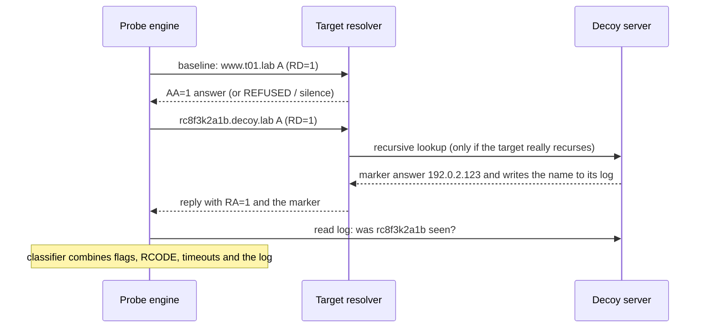
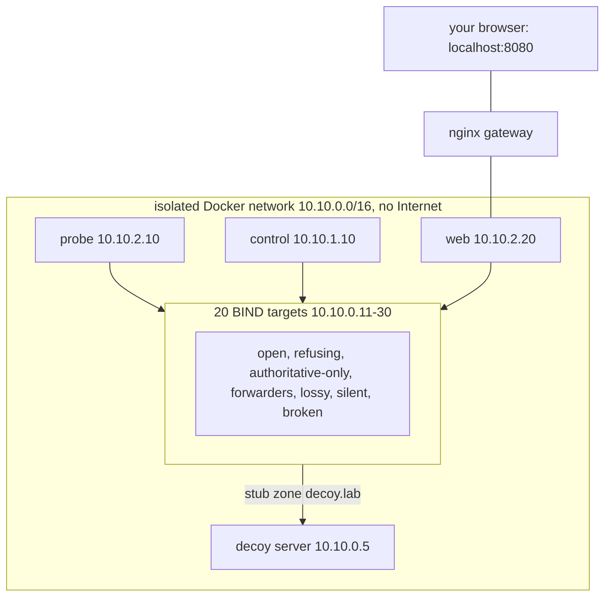

# Architecture

## Components (package `rcheck/`)

| Module | Responsibility |
|---|---|
| `guard.py` | **Scope guard:** only allow-listed addresses inside the lab network, at most 20 targets, only A/TXT queries |
| `rate.py` | **Rate controller:** token buckets per target and global |
| `probe.py` | **Probe engine:** builds RD=1 queries with dnspython, sends over UDP (TCP on truncation), timeout and retry limits, records flags, RCODE, answers, timing |
| `decoylog.py` | **Evidence collector (decoy side):** reads the decoy server's log; only lines written after the run started count |
| `engine.py` | Probing sequence for one target: baseline, then N decoy queries with seeded unique names |
| `classifier.py` | Ordered rules, reason codes, evidence strength, decision trace |
| `naive.py` | Naive RA-flag scanner used as a comparison baseline |
| `score.py` | **Ground-truth comparator:** confusion matrix, precision/recall, coverage |
| `report.py` | **Exposure report:** self-contained HTML (print to PDF), including rate-control proof from the audit log |
| `audit.py` | Append-only JSONL log of every query |
| `run.py` | Command-line runner: dry-run, kill switch (Ctrl+C), seed and replay, result files |
| `web.py`, `web_index.html` | Web interface |
| `control.py` | Control client script (run from inside the allowed network range) |

## Query flow for one server

## Lab network

## Design decisions

- **Decoy log as evidence.** The RA flag only says what a server claims. A name that reaches our own server proves a lookup happened. Names are unique per attempt, so caching cannot hide the result.
- **Delegation without a real root.** The lab has no Internet, so each recursive target is configured with a stub zone for `decoy.lab` pointing at the decoy server. The target still performs a genuine recursive query to reach it.
- **Match by unique name, not by source address.** A forwarder's lookup reaches the decoy server from its upstream's address, so the name is the identifier.
- **Only log lines written after the run started count** (a byte offset is recorded), so a replay cannot be satisfied by old log entries.
- **Ground truth is separate from detection.** `targets.yaml` labels are used only for scoring and are never visible to the classifier.
- **Web safety.** The browser sends a target name; the server maps it through the allow-list. The `web` container stays on the isolated network; because Docker cannot publish ports from an internal network, a tiny nginx `gateway` proxies `127.0.0.1:8080` to it and does nothing else.
- **Evidence over speed.** Three attempts must agree; disagreement becomes `CONFLICT`, not a guess.

## Safety controls

Authorised lab only; real source address; small A/TXT queries only (never ANY); configurable rate limits; dry-run mode;
Ctrl+C stops after the current query and writes partial results; every query is in `audit.jsonl`.
